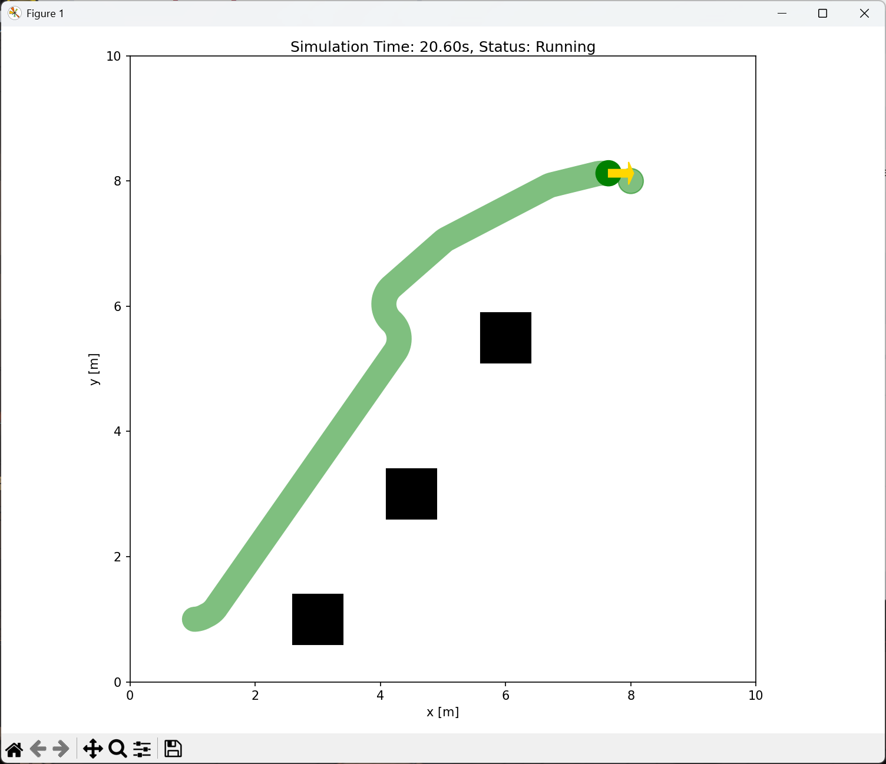
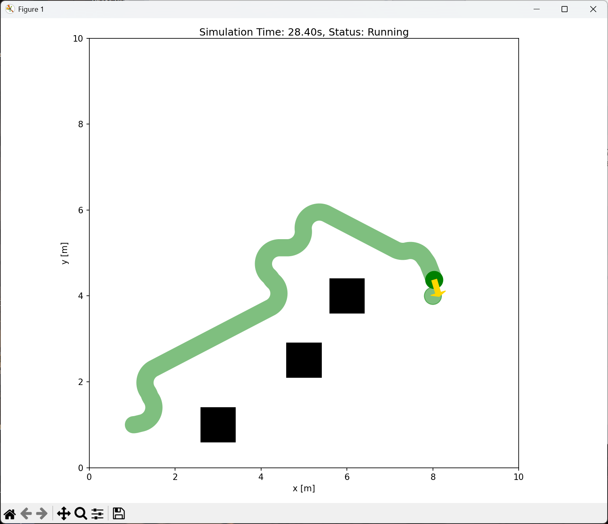
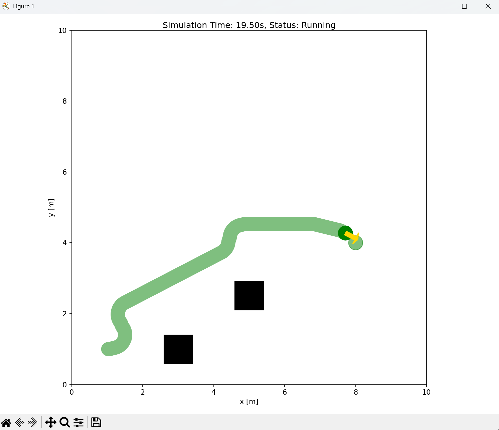
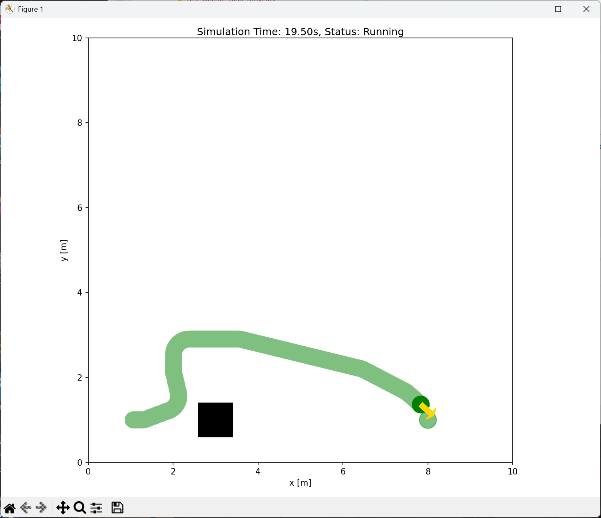

# SCSE '26 Agent‑Based Software Engineering Project

> 
> Repository Name: `scse_agentic_se_deepsleep`
> Course: Special Course in Software Engineering '26, University of Oulu
> Group work: All development, testing, integration completed as group work. External chat‑based remote communication was not used for group collaboration, following course requirements.

## Project Overview

This project implements a **multi‑agent AI‑driven software engineering pipeline** for robot navigation logic generation.
We build a chain of specialised LLM‑powered agents (Analyst → Planner → Developer → Test Agent → Reviewer → Benchmark Reviewer). Each agent consumes artifacts produced by the previous agent, respecting **context isolation**: agents only receive the formal output artifact from upstream, not full conversation history.

The pipeline takes natural‑language customer brief (`brief.txt`), transforms it step‑by‑step into:

1. Formal structured requirements JSON (`artifacts/requirements.json`)
2. Navigation strategy plan JSON (`artifacts/plan.json`)
3. Executable Python navigation logic (`generated/navigation_logic.py`) with mandatory entry‑point `decide_next_move(state)`
4. Auto‑generated behavioural test code for navigation logic
5. Simulation reports and benchmark reports via IR‑SIM simulator
6. Automated review outputs to detect safety, goal‑completion and efficiency issues
7. Optional revision loop: regenerate navigation code if benchmark review signals revision is needed.

Robot navigation rules derived from brief.txt:

- Robot receives sensor state: `front_blocked`, `left_blocked`, `right_blocked`, `goal_ahead`, `goal_on_left`, `goal_on_right`
- Valid actions only: `FORWARD`, `LEFT`, `RIGHT`, `STOP`
- Prioritise moving toward goal **only if direction is not blocked**; never drive into obstacles
- Safe‑stop: return `STOP` when all directions are blocked
- Goal detection is handled externally by IR‑SIM simulator, not inside `decide_next_move()`.

## File Structure

```
scse_agentic_se_groupname/
├── brief.txt                         # Original human‑language customer brief
├── robot_requirements.txt            # Raw natural‑language requirements extracted by brief_to_req.py
├── brief_to_req.py                   # Convert brief.txt into human‑readable requirement text
├── analyst_agent.py                  # Analyst Agent: brief → validated requirements JSON
├── run_analyst.py                    # Runner for analyst agent, writes artifacts/requirements.json
├── test_analyst.py                   # Level‑1 smoke test for Analyst Agent
├── planner_agent.py                  # Planner Agent: requirements → navigation plan JSON
├── run_planner.py                    # Runner for planner agent, writes artifacts/plan.json
├── test_planner.py                   # Level‑1 smoke test for Planner Agent
├── developer_agent.py                # Developer Agent & revision agent: plan → Python navigation code
├── run_developer.py                  # Runner for developer agent, writes generated/navigation_logic.py
├── test_developer.py                 # Level‑1 smoke test for Developer Agent
├── test_agent.py                     # Test Agent: auto‑generate pytest‑style test code for decide_next_move()
├── reviewer_agent.py                 # Reviewer Agent: analyse unit‑simulation report
├── reviewer_benchmark_agent.py       # Benchmark Reviewer Agent: analyse IR‑SIM benchmark results
├── runner.py                         # Simple behavioural simulation runner for decide_next_move()
├── benchmark_irsim.py                # Automated IR‑SIM benchmark across all simulation worlds
├── main.py                           # Orchestrator: full end‑to‑end pipeline, writes trace.log
├── run_visual.sh                     # Shell script for visual IR‑SIM simulation
├── test_irsim_with_agent.py          # IR‑SIM simulation glue code, calls decide_next_move(state)
├── test_generated_navigation_logic.py # Level‑2 behavioural test suite for navigation logic
├── artifacts/                        # All pipeline output artifacts (JSON reports)
│   ├── requirements.json
│   ├── plan.json
│   ├── simulation_report.json
│   ├── sim_review_notes.json
│   ├── irsim_report.json
│   ├── irsim_benchmark_report.json
│   └── benchmark_review_notes.json
├── generated/                        # LLM‑generated source & test code
│   ├── navigation_logic.py
│   ├── revised_navigation_logic.py
│   └── test_decide_next_move.py
├── irsim_worlds/                     # IR‑SIM simulation world YAML files
│   ├── world_easy.yaml
│   ├── world_medium.yaml
│   ├── world_hard.yaml
│   └── world_custom.yaml
└── trace.log                         # Full pipeline execution log generated by main.py
```

## Agent Pipeline Detailed Description

### 1. Analyst Agent (`analyst_agent.py`)

Responsibility: Transform natural‑language brief into strictly‑schema validated JSON requirements.

- `build_prompt()`: System prompt defines role, output JSON schema, constraints.
- `ask_qwen()`: Call Qwen3‑8b LLM via Ollama.
- `validate_requirements()`: Validates dict structure, keys, value types, allowed action list; raises exceptions for invalid output.
- `run_analyst(brief)`: Full workflow: prompt → LLM call → JSON parse → validation → return requirements dict.

Output artifact: `artifacts/requirements.json`
Schema keys:

- `goal`: string navigation objective
- `allowed_actions`: fixed list `["FORWARD","LEFT","RIGHT","STOP"]`
- `safe_stop`: boolean
- `avoid_obstacles`: boolean

### 2. Planner Agent (`planner_agent.py`)

Responsibility: Take validated requirements artifact, produce high‑level navigation plan for developer agent, no access to original brief or analyst conversation history (context isolation).

- System prompt enforces output JSON schema for plan.
- `validate_plan()`: Check dict, required keys, value types, valid action list.
- `run_planner(requirement)`: send requirements to LLM, parse and validate JSON string.

Output artifact: `artifacts/plan.json`
Schema keys:

- `strategy`: string high‑level navigation strategy
- `decisions`: list of allowed robot actions
- `stop_condition`: string describing when robot must execute STOP

### 3. Developer Agent (`developer_agent.py`)

Responsibility: Generate pure Python navigation implementation from planner plan artifact.
Hard mandatory constraints:

- Public entry function **`def decide_next_move(state):`**, only this function shall be called externally.
- Helper functions use underscore prefix `_helper()`.
- `state` dictionary only contains: `front_blocked`, `left_blocked`, `right_blocked`, `goal_ahead`, `goal_on_left`, `goal_on_right`.
- Critical rule: **always check obstacle blocked flags before evaluating goal direction; never move into blocked direction**.
- Return only one of: `"FORWARD"`, `"LEFT"`, `"RIGHT"`, `"STOP"`.

Functions:

- `clean_llm_python_output()`: Sanitize LLM output: remove markdown ``` fences, extra prose, locate start of `decide_next_move`.
- `validate_develop(code)`: Python syntax compile check for generated source code.
- `run_developer(plan)`: main generation workflow.
- `run_developer_revision()`: revision workflow; takes original navigation code + review notes + benchmark report + requirements + plan, produce revised navigation logic.

Output artifact: `generated/navigation_logic.py`

### 4. Test Agent (`test_agent.py`)

Responsibility: Generate pytest‑style test code for `decide_next_move(state)` based on requirements and plan.

- Output pure Python test code starting with import `from generated.navigation_logic import decide_next_move`.
- Test functions start with `test_` and use assert statements.
- `clean_test_output()`: sanitize LLM test output, remove markdown fences, prevent duplicate definition of decide_next_move.
- `validate_test_code()`: syntax check and keyword validation.

Output artifact: `generated/test_decide_next_move.py`

### 5. Simulation Runner (`runner.py`)

Light‑weight level‑2 behavioural simulation, runs fixed hand‑written test scenarios against `decide_next_move(state)`, produce `simulation_report.json` with pass/fail status for each scenario.

### 6. Reviewer Agent (`reviewer_agent.py`)

Analyse simple simulation report from runner.py. Output JSON with:

- `issue`: string description of problem
- `likely_cause`: root‑cause guess
- `recommendation`: improvement advice
- `needs_revision`: boolean flag whether code revision is required.

Output artifact: `artifacts/sim_review_notes.json`

### 7. IR‑SIM & Benchmark (`test_irsim_with_agent.py`, `benchmark_irsim.py`)

IR‑SIM is realistic 2D robot navigation simulator.

- `test_irsim_with_agent.py`: Load world yaml, build `state` perception from robot sensor simulation, repeatedly invoke `decide_next_move(state)`, run simulation steps, produce single‑world report `irsim_report.json`.
- `benchmark_irsim.py`: Automatically iterate all four worlds (`easy / medium / hard / custom`), aggregate metrics:
  - `success_rate`: fraction of worlds where robot reaches goal
  - `efficiency_rate`: fraction of runs finishing within efficient step limit (<=200 steps)
  - `average_steps_taken`: average steps across all worlds
  - Detailed per‑world results including collision status, steps taken, efficiency classification (`efficient` / `acceptable_but_inefficient` / `failed`)

Output artifact: `artifacts/irsim_benchmark_report.json`

### 8. Benchmark Reviewer Agent (`reviewer_benchmark_agent.py`)

Evaluate benchmark report on three quality dimensions: **safety, goal completion, efficiency**.

- `build_deterministic_review()`: deterministic logic computes boolean pass/fail flags independent of LLM:
  - `safety_passed`: no run ends with collision without reaching goal
  - `goal_completion_passed`: success_rate == 1.0
  - `efficiency_passed`: zero inefficient runs and efficiency_rate ==1.0
  - `needs_revision`: True if any of safety / goal / efficiency fails
- LLM rewrites human‑readable text fields (`issue`, `likely_cause`, `recommendation`), boolean flags are forced from deterministic calculation to avoid LLM hallucination.

Output artifact: `artifacts/benchmark_review_notes.json`

### 9. Orchestrator (`main.py`)

Central pipeline entry point. Executes agents sequentially, creates directories `artifacts/` and `generated/`, logs every step to `trace.log`. Optional revision loop can be enabled: when benchmark review `needs_revision = True`, trigger developer revision agent, overwrite navigation logic, re‑run simulation and benchmark.

### Test suite files (Course testing requirements)

Project requires two‑level testing strategy:

1. **Level 1: Agent smoke tests**
   - `test_analyst.py`: run analyst agent end‑to‑end, verify `requirements.json` is generated correctly
   - `test_planner.py`: run planner agent end‑to‑end, verify `plan.json` output
   - `test_developer.py`: run developer agent end‑to‑end, verify `navigation_logic.py` output
2. **Level 2: Behavioural testing for navigation logic**
   - `test_generated_navigation_logic.py`: import generated `decide_next_move(state)`, feed hand‑crafted state test cases, assert expected actions. Includes intentional bug injection exercise: introduce defect into navigation_logic.py to verify tests catch failure, then remove bug again as per course instructions.

## Simulation Benchmark Results

## Simulation Benchmark Results
Terminal output screenshots from running `benchmark_irsim.py`:


<br>

<br>

<br>


> 
> Results from `artifacts/irsim_benchmark_report.json`

```
{
  "total_worlds": 4,
  "goals_reached": 4,
  "success_rate": 1.0,
  "efficient_worlds": 2,
  "inefficient_success_worlds": 2,
  "failed_worlds": 0,
  "efficiency_rate": 0.5,
  "average_steps_taken": 220.0,
  "results": [
    {
      "reached_goal": true,
      "collision_or_done": false,
      "steps_taken": 195,
      "max_steps_allowed": 300,
      "efficient_step_limit": 200,
      "efficiency_status": "efficient",
      "world_file": "irsim_worlds/world_easy.yaml"
    },
    {
      "reached_goal": true,
      "collision_or_done": false,
      "steps_taken": 195,
      "max_steps_allowed": 300,
      "efficient_step_limit": 200,
      "efficiency_status": "efficient",
      "world_file": "irsim_worlds/world_medium.yaml"
    },
    {
      "reached_goal": true,
      "collision_or_done": false,
      "steps_taken": 206,
      "max_steps_allowed": 300,
      "efficient_step_limit": 200,
      "efficiency_status": "acceptable_but_inefficient",
      "world_file": "irsim_worlds/world_hard.yaml"
    },
    {
      "reached_goal": true,
      "collision_or_done": false,
      "steps_taken": 284,
      "max_steps_allowed": 300,
      "efficient_step_limit": 200,
      "efficiency_status": "acceptable_but_inefficient",
      "world_file": "irsim_worlds/world_custom.yaml"
    }
  ]
}
```

## Review Notes

### Simulation review notes (`artifacts/sim_review_notes.json`)

```
{
  "issue": "",
  "likely_cause": "",
  "recommendation": "",
  "needs_revision": false
}
```

The simple unit‑scenario simulation (`runner.py`) has 100% pass rate for all 6 test scenarios. No defects found in basic behavioural test cases, revision is **not required** based only on small‑scale simulation.

### Benchmark review notes (`artifacts/benchmark_review_notes.json`)

```
{
  "issue": "Successful but inefficient navigation",
  "likely_cause": "Two worlds exceeded efficient step limits (200 steps), with one requiring 284 steps. This suggests suboptimal pathfinding in complex environments.",
  "recommendation": "Optimize pathfinding algorithms or adjust parameters to reduce step counts in medium/hard scenarios without compromising goal completion.",
  "safety_passed": true,
  "goal_completion_passed": true,
  "efficiency_passed": false,
  "needs_revision": true
}
```

Benchmark review conclusion:

- Safety requirement satisfied; robot respects obstacle avoidance.
- Goal completion requirement satisfied; robot can find goal in all simulated environments.
- Efficiency requirement **not satisfied**. Hard and custom worlds take too many steps. Therefore revision flag set to `true`. The pipeline can trigger `run_developer_revision()` to generate improved navigation logic.

## How to run the project

### Prerequisites

1. Install IR‑SIM simulator:

```
uv pip install ir‑sim
```

2. Ollama running locally, model `qwen3:8b` pulled.

```
ollama pull qwen3:8b
```

### 1. Run full end‑to‑end agent pipeline

```
python main.py
```

This will execute analyst → planner → developer → test agent → simulation → reviewer → benchmark → benchmark reviewer. Output artifacts appear under `artifacts/` and `generated/`. Full execution log saved in `trace.log`.

### 2. Run individual agent runners

```
python run_analyst.py
python run_planner.py
python run_developer.py
```

### 3. Run Level‑1 agent smoke tests

```
python test_analyst.py
python test_planner.py
python test_developer.py
```

### 4. Run Level‑2 behavioural test for navigation logic

```
python test_generated_navigation_logic.py
```

### 5. Visual IR‑SIM simulation

```
bash run_visual.sh irsim_worlds/world_easy.yaml
bash run_visual.sh irsim_worlds/world_medium.yaml
bash run_visual.sh irsim_worlds/world_hard.yaml
bash run_visual.sh irsim_worlds/world_custom.yaml
```

### 6. Automated benchmark across all worlds

```
python benchmark_irsim.py
```

## AI‑Generated Code Snippets

#### run_developer.py
```
system_prompt = '''
You are the Developer Agent in a multi‑agent software engineering system.
# Role
Your task is to implement robot navigation Python code based **only on the provided plan artifact** from the Planner Agent. You must not invent new logic or requirements that do not exist inside the input plan. Your generated code will be saved into navigation_logic.py for execution.
# Expected output format
Produce Python source code.
DO NOT write natural‑language explanations, summaries, notes outside of the code. No JSON output, only Python code.
DO NOT use markdown lists, bullet points, → arrow symbols, ** bold markup. Output pure Python only.

# Mandatory code requirements
1. You MUST create exactly one public entry‑point function with exact name: `def decide_next_move(state):`
    - Parameter `state` is a dictionary holding robot sensor perception data, passed in from external caller (test script / simulator).
    - NEVER hard‑code or generate state values inside this function; state is input argument only.
    - Return one valid action string from allowed set: FORWARD, LEFT, RIGHT, STOP.
2. Place all supporting helper logic inside this file. Helper functions should be private (prefix with underscore `_`).
    - IMPORTANT: External agents / test programs may ONLY call `decide_next_move(state)`. No helper functions shall be invoked from outside the file.
3. Implement the navigation strategy described in input plan "strategy".
4. Use only allowed actions: FORWARD, LEFT, RIGHT, STOP.
5. Implement the stop‑condition logic specified in "stop_condition" from the plan.
6. Reference the possible decisions listed under "decisions" in the input plan.

IMPORTANT ABOUT state DICTIONARY:
The input `state` ONLY contains these keys:
"front_blocked", "left_blocked", "right_blocked", "goal_ahead", "goal_on_left", "goal_on_right".
DO NOT access keys like "position", "target", "goal_x", "goal_y", they DO NOT EXIST in state.
You cannot read robot coordinates from state.
Reaching‑goal detection is handled OUTSIDE by simulator.
Use `if state["goal_ahead"]:` style checks, DO NOT use "is True" / "is False".

CRITICAL LOGIC ORDER RULE:
ALWAYS CHECK OBSTACLE BLOCK STATUS BEFORE MOVING TOWARD GOAL.
NEVER return FORWARD if front_blocked is True, even if goal_ahead is True.
If goal_ahead is True but front_blocked is True, you CANNOT choose FORWARD; you must turn LEFT or RIGHT instead.
Check blocked‑flags first, then check goal directions.


# Rules you must follow
1. Do not add requirements or behaviour not present in the input plan artifact.
2. Do not output any text other than the Python code.
'''

revision_system_prompt = '''
NO introductory explanation text, NO analysis paragraphs, output ONLY Python code, zero natural‑language text before def decide_next_move.

You are the Developer Revision Agent. Fix robot navigation Python code.
Input: original navigation code, review notes, benchmark report, requirements, planner plan.

Constraints:
1. Keep entry point `def decide_next_move(state):` unchanged signature.
2. Output ONLY pure Python code. No markdown, no lists, no arrows, no explanations.
3. Fix bugs from review and benchmark. Do NOT change core strategy/stop‑condition from plan.
4. Helper functions start with underscore. Return only FORWARD, LEFT, RIGHT, STOP.

IMPORTANT ABOUT state DICTIONARY:
The input `state` ONLY contains these keys:
"front_blocked", "left_blocked", "right_blocked", "goal_ahead", "goal_on_left", "goal_on_right".
DO NOT access keys like "position", "target", "goal_x", "goal_y", they DO NOT EXIST in state.
You cannot read robot coordinates from state.
Reaching‑goal detection is handled OUTSIDE by simulator.
Use `if state["goal_ahead"]:` style checks, DO NOT use "is True" / "is False".

CRITICAL LOGIC ORDER RULE:
ALWAYS CHECK OBSTACLE BLOCK STATUS BEFORE MOVING TOWARD GOAL.
NEVER return FORWARD if front_blocked is True, even if goal_ahead is True.
If goal_ahead is True but front_blocked is True, you CANNOT choose FORWARD; you must turn LEFT or RIGHT instead.
Check blocked‑flags first, then check goal directions.
'''

def clean_llm_python_output(raw_text: str) -> str:
    lines = raw_text.splitlines()
    out_lines = []
    in_block = False
    for line in lines:
        s = line.strip()
        if s.startswith("```"):
            if "python" in s.lower():
                in_block = True
            elif s == "```":
                in_block = False
            continue
        if "---" in s:
            continue
        out_lines.append(line)

    combined = "\n".join(out_lines).strip()
    code_lines = combined.splitlines()
    start_idx = 0
    for i, cl in enumerate(code_lines):
        if cl.lstrip().startswith("def decide_next_move"):
            start_idx = i
            break
    return "\n".join(code_lines[start_idx:]).strip()

def validate_develop(code):
    if code.strip() == "":
        raise TypeError("data cannot be empty")
    try:
        compile(code, filename="<generated_code>", mode="exec")
    except SyntaxError as e:
        raise ValueError(f"Generated Python code has syntax error: {e}")
    return True
```
#### benchmark_irsim.py
```
import json
import subprocess
from pathlib import Path

WORLD_LIST = [
    Path("irsim_worlds") / "world_easy.yaml",
    Path("irsim_worlds") / "world_medium.yaml",
    Path("irsim_worlds") / "world_hard.yaml",
    Path("irsim_worlds") / "world_custom.yaml"
]

def run_single_world(world_file: Path) -> dict:
    proc = subprocess.run(
        ["python","test_irsim_with_agent.py", str(world_file)],
        capture_output=True,
        text=True
    )
    if proc.returncode !=0:
        raise RuntimeError(f"World {world_file} failed run:\nSTDERR:\n{proc.stderr}\nSTDOUT:\n{proc.stdout}")
    with open(Path("artifacts")/"irsim_report.json","r",encoding="utf-8") as f:
        single_report = json.load(f)
    single_report["world_file"] = str(world_file)
    return single_report


def run_all_benchmark():
    results = []
    for w in WORLD_LIST:
        r = run_single_world(w)
        results.append(r)

    total = len(results)
    reached_goal_count = sum(1 for x in results if x["reached_goal"])
    efficient_count = sum(1 for x in results if x["efficiency_status"]=="efficient")
    inefficient_success_count = sum(1 for x in results if x["efficiency_status"]=="acceptable_but_inefficient")
    failed_count = sum(1 for x in results if not x["reached_goal"])
    total_steps = sum(x["steps_taken"] for x in results)

    success_rate = reached_goal_count / total if total>0 else 0.0
    efficiency_rate = efficient_count / total if total>0 else 0.0
    average_steps = total_steps / total if total>0 else 0.0

    benchmark_report = {
        "total_worlds": total,
        "goals_reached": reached_goal_count,
        "success_rate": success_rate,
        "efficient_worlds": efficient_count,
        "inefficient_success_worlds": inefficient_success_count,
        "failed_worlds": failed_count,
        "efficiency_rate": efficiency_rate,
        "average_steps_taken": average_steps,
        "results": results
    }
    out_path = Path("artifacts")/"irsim_benchmark_report.json"
    with open(out_path,"w",encoding="utf-8") as f:
        json.dump(benchmark_report, f, indent=2)
    print(json.dumps(benchmark_report,indent=2))
    return benchmark_report


if __name__ == "__main__":
    run_all_benchmark()
```
### main.py
```
from analyst_agent import run_analyst
from planner_agent import run_planner
from developer_agent import run_developer, run_developer_revision
from test_agent import run_test_agent
from runner import run_simulation
from reviewer_agent import run_reviewer_agent
from benchmark_irsim import run_all_benchmark
from reviewer_benchmark_agent import run_benchmark_reviewer_agent

TRACE_LOG = Path("trace.log")

def log_event(message: str):
    line = f"{message}\n"
    print(line.rstrip("\n"))
    with open(TRACE_LOG, "a", encoding="utf-8") as f:
        f.write(line)

def ensure_directories():
    Path("artifacts").mkdir(exist_ok=True)
    Path("generated").mkdir(exist_ok=True)

def read_text_file(filepath: Path) -> str:
    with open(filepath, "r", encoding="utf-8") as f:
        return f.read()

def write_json_artifact(data: dict, filename: str):
    out = Path("artifacts") / filename
    with open(out, "w", encoding="utf-8") as f:
        json.dump(data, f, indent=2)

def write_text_generated(text: str, filename: str):
    out = Path("generated") / filename
    with open(out, "w", encoding="utf-8") as f:
        f.write(text)

def run_full_integration_pipeline():
    ensure_directories()
    if TRACE_LOG.exists():
        TRACE_LOG.unlink()

    log_event("==== Starting Integration & Simulation full pipeline ====")

    log_event("Orchestrator: Loading brief.txt")
    brief_text = read_text_file(Path("brief.txt"))

    log_event("Analyst Agent: executing run_analyst()")
    requirements = run_analyst(brief_text)
    write_json_artifact(requirements, "requirements.json")
    log_event('Analyst Agent created artifacts/requirements.json')

    log_event("Planner Agent: executing run_planner()")
    plan_json_str = run_planner(requirements)
    plan = json.loads(plan_json_str)
    write_json_artifact(plan, "plan.json")
    log_event('Planner Agent created artifacts/plan.json')

    log_event("Developer Agent: executing run_developer()")
    nav_code = run_developer(plan)
    write_text_generated(nav_code, "navigation_logic.py")
    log_event("Developer Agent created generated/navigation_logic.py")

    log_event("Test Agent: executing run_test_agent()")
    generated_test_code = run_test_agent(requirements, plan)
    write_text_generated(generated_test_code, "test_decide_next_move.py")
    log_event("Test Agent created generated/test_decide_next_move.py")

    log_event("Simulation Runner: executing run_simulation()")
    sim_report = run_simulation()
    write_json_artifact(sim_report, "simulation_report.json")
    log_event("Simulation Runner created artifacts/simulation_report.json")

    log_event("Reviewer Agent: executing run_reviewer_agent()")
    sim_review = run_reviewer_agent(sim_report)
    write_json_artifact(sim_review, "sim_review_notes.json")
    log_event("Reviewer Agent created artifacts/sim_review_notes.json")

    log_event("IRSIM Benchmark: executing run_all_benchmark()")
    bench_report = run_all_benchmark()
    log_event("IRSIM Benchmark created artifacts/irsim_benchmark_report.json")

    log_event("Benchmark Reviewer Agent: executing run_benchmark_reviewer_agent()")
    bench_review = run_benchmark_reviewer_agent(bench_report)
    write_json_artifact(bench_review, "benchmark_review_notes.json")
    log_event("Benchmark Reviewer Agent created artifacts/benchmark_review_notes.json")

    log_event("==== Pipeline execution finished ====")
```
### reviewer_agent.py
```
reviewer_sys_prompt = '''
You are simulation reviewer agent. Analyze simulation report.
Output ONLY pure JSON, no markdown, no extra text.
Keys required:
"issue": string describing problem, empty string if no issue.
"likely_cause": string guess root cause.
"recommendation": string improvement advice.
"needs_revision": boolean true/false.
If success_rate >=0.9 set needs_revision false; else true.
'''

def validate_reviewer_output(data:dict) -> bool:
    required_keys = {"issue","likely_cause","recommendation","needs_revision"}
    if not isinstance(data,dict):
        raise ValueError("Review output must be dict")
    if not required_keys.issubset(set(data.keys())):
        raise ValueError(f"Missing keys, need {required_keys}")
    if not isinstance(data["needs_revision"], bool):
        raise ValueError("needs_revision must be boolean")
    for k in ("issue","likely_cause","recommendation"):
        if not isinstance(data[k], str):
            raise ValueError(f"{k} must be string")
    return True
    
    
```
### reviewer_benchmark_agent.py
```
import json
from ollama import chat

benchmark_reviewer_sys = '''
You are benchmark reviewer agent.
You receive benchmark report AND a deterministic review template with fixed boolean flags.
You must keep all boolean values EXACTLY as given in deterministic review.
Only rewrite natural‑language text for issue, likely_cause, recommendation.
Output ONLY pure JSON object, no markdown, no extra text.
Required keys: issue(str), likely_cause(str), recommendation(str), safety_passed(bool), goal_completion_passed(bool), efficiency_passed(bool), needs_revision(bool).
'''

def validate_benchmark_review(data:dict) -> bool:
    req_keys = {"issue","likely_cause","recommendation","safety_passed","goal_completion_passed","efficiency_passed","needs_revision"}
    if not isinstance(data,dict):
        raise ValueError("Must be dict")
    if not req_keys.issubset(data.keys()):
        raise ValueError(f"Missing keys: {req_keys}")
    for boolkey in ("safety_passed","goal_completion_passed","efficiency_passed","needs_revision"):
        if not isinstance(data[boolkey],bool):
            raise ValueError(f"{boolkey} must be boolean")
    for skey in ("issue","likely_cause","recommendation"):
        if not isinstance(data[skey],str):
            raise ValueError(f"{skey} must be string")
    return True


def build_deterministic_review(benchmark_report:dict) -> dict:
    safety_passed = True
    for res in benchmark_report.get("results",[]):
        if res.get("collision_or_done") is True and res.get("reached_goal") is False:
            safety_passed = False
            break

    success_rate = benchmark_report.get("success_rate",0.0)
    goal_completion_passed = (success_rate >=1.0)

    inefficient_success = benchmark_report.get("inefficient_success_worlds",0)
    eff_rate = benchmark_report.get("efficiency_rate",0.0)
    efficiency_passed = (inefficient_success ==0 and eff_rate >=1.0)

    needs_revision = not (safety_passed and goal_completion_passed and efficiency_passed)

    issue = ""
    if not safety_passed:
        issue = "Unsafe benchmark behavior detected"
    elif not goal_completion_passed:
        issue = "Goal completion failure"
    elif not efficiency_passed:
        issue = "Successful but inefficient navigation"

    return {
        "issue":issue,
        "likely_cause":"",
        "recommendation":"",
        "safety_passed":safety_passed,
        "goal_completion_passed":goal_completion_passed,
        "efficiency_passed":efficiency_passed,
        "needs_revision":needs_revision
    }


def run_benchmark_reviewer_agent(benchmark_report:dict) -> dict:
    det_review = build_deterministic_review(benchmark_report)
    user_payload = {
        "benchmark_report": benchmark_report,
        "deterministic_review_fixed_booleans": det_review
    }
    resp = chat(
        model="qwen3:8b",
        messages=[
            {"role":"system","content":benchmark_reviewer_sys},
            {"role":"user","content":json.dumps(user_payload,indent=2)}
        ]
    )
    raw = resp.message.content
    parsed = json.loads(raw)
    # force boolean flags from deterministic review (defend against llm changing bools)
    parsed["safety_passed"] = det_review["safety_passed"]
    parsed["goal_completion_passed"] = det_review["goal_completion_passed"]
    parsed["efficiency_passed"] = det_review["efficiency_passed"]
    parsed["needs_revision"] = det_review["needs_revision"]
    validate_benchmark_review(parsed)
    return parsed
```
### runner.py
```
def run_simulation():
    from generated.navigation_logic import decide_next_move

    scenarios = [
        {"state":{"front_blocked":False,"left_blocked":False,"right_blocked":False,"goal_ahead":True,"goal_on_left":False,"goal_on_right":False}, "expected":"FORWARD"},
        {"state":{"front_blocked":True,"left_blocked":False,"right_blocked":False,"goal_ahead":True,"goal_on_left":False,"goal_on_right":False}, "expected":"LEFT"},
        {"state":{"front_blocked":True,"left_blocked":True,"right_blocked":False,"goal_ahead":False,"goal_on_left":False,"goal_on_right":True}, "expected":"RIGHT"},
        {"state":{"front_blocked":False,"left_blocked":True,"right_blocked":False,"goal_ahead":False,"goal_on_left":False,"goal_on_right":True}, "expected":"RIGHT"},
        {"state":{"front_blocked":False,"left_blocked":False,"right_blocked":True,"goal_ahead":False,"goal_on_left":True,"goal_on_right":False}, "expected":"LEFT"},
        {"state":{"front_blocked":True,"left_blocked":True,"right_blocked":True,"goal_ahead":False,"goal_on_left":False,"goal_on_right":False}, "expected":"STOP"}
    ]
    results = []
    passed = 0
    failed = 0
    for sc in scenarios:
        act = decide_next_move(sc["state"])
        ok = (act == sc["expected"])
        if ok:
            passed +=1
        else:
            failed +=1
        results.append({
            "state":sc["state"],
            "expected":sc["expected"],
            "actual":act,
            "pass":ok
        })
    total = len(scenarios)
    success_rate = passed / total if total>0 else 0.0
    report = {
        "total_scenarios":total,
        "passed_scenarios":passed,
        "failed_scenarios":failed,
        "success_rate":success_rate,
        "scenario_results":results
    }
    return report
```
### test_agent.py
```
import json
from ollama import chat

SYSTEM_PROMPT = """
You are the Test Agent in a multi-agent software engineering system.
# Role
Generate pytest-style test code for the robot navigation function
`decide_next_move(state)`.
# Input
- requirements: JSON object with the navigation requirements
- plan: JSON object with the navigation plan
# MANDATORY OUTPUT RULES
1. Output ONLY pure Python test code. Nothing else.
2. NO explanations, NO markdown, NO ``` fences, NO comments outside the code.
3. The VERY FIRST line of your output MUST be exactly:
   from generated.navigation_logic import decide_next_move
4. Do NOT define the `decide_next_move` function yourself. It already exists.
   You only IMPORT it and TEST it.
5. Every test function name MUST start with `test_`.
6. Each test MUST call `decide_next_move(state)` and use `assert` to check
   the returned action.
# State dictionary keys
- `front_blocked` (bool)
- `left_blocked` (bool)
- `right_blocked` (bool)
- `goal_ahead` (bool)
- `goal_on_left` (bool)
- `goal_on_right` (bool)
- `target_reached` (bool)
# Required test coverage
- Goal reached → STOP
- Goal ahead and clear → FORWARD
- Front blocked but goal on left → LEFT
- Front blocked but goal on right → RIGHT
- All directions blocked → STOP
# Example of the FIRST 3 lines of your output
from generated.navigation_logic import decide_next_move
def test_goal_reached():
    ...
"""


def clean_test_output(raw_text: str) -> str:
    lines = raw_text.splitlines()
    out_lines = []
    in_fence = False
    for line in lines:
        s = line.strip()
        if s.startswith("```"):
            in_fence = not in_fence
            continue
        out_lines.append(line)
    code = "\n".join(out_lines).strip()

    required_import = "from generated.navigation_logic import decide_next_move"
    if not code.startswith(required_import):
        if required_import not in code:
            code = required_import + "\n\n" + code

    final_lines = []
    skip_def = False
    for l in code.splitlines():
        if l.lstrip().startswith("def decide_next_move"):
            skip_def = True
            continue
        if skip_def:
            if l and not l.startswith((" ", "\t")):
                skip_def = False
            else:
                continue
        final_lines.append(l)
    return "\n".join(final_lines).strip()


def validate_test_code(code):
    if not isinstance(code, str):
        raise TypeError("Test code must be a string")
    if code.strip() == "":
        raise ValueError("Test code cannot be empty")
    if "```" in code:
        raise ValueError("Test code must not contain markdown code fences")
    required_keywords = [
        "def test_",
        "from generated.navigation_logic import decide_next_move",
        "decide_next_move(",
        "assert",
    ]
    for keyword in required_keywords:
        if keyword not in code:
            raise ValueError(f"Test code is missing required keyword: {keyword}")
    try:
        compile(code, filename="<generated_test>", mode="exec")
    except SyntaxError as e:
        raise ValueError(f"Generated test code has syntax error: {e}")
    return True


def run_test_agent(requirements, plan):
    user_prompt = (
        "REQUIREMENTS:\n"
        + json.dumps(requirements, indent=4)
        + "\n\nPLAN:\n"
        + json.dumps(plan, indent=4)
        + "\n\nGenerate ONLY the pytest test code. "
        "Start with the import line. No markdown, no explanations."
    )
    response = chat(
        model="qwen3:8b",
        messages=[
            {"role": "system", "content": SYSTEM_PROMPT},
            {"role": "user", "content": user_prompt},
        ],
    )
    raw_code = response.message.content
    test_code = clean_test_output(raw_code)
    validate_test_code(test_code)
    return test_code
```
### test_irsim_with_agent.py
```
import math
import irsim
import json
import os
import numpy as np
import matplotlib.pyplot as plt
import time
import sys
from generated.navigation_logic import decide_next_move

os.makedirs("artifacts", exist_ok=True)

MAX_STEPS = 300
EFFICIENT_STEP_LIMIT = 200


def classify_efficiency(reached_goal_status, steps_taken):

    if not reached_goal_status:
        return "failed"
    if steps_taken <= EFFICIENT_STEP_LIMIT:
        return "efficient"
    return "acceptable_but_inefficient"


def normalize_angle(angle):
    while angle > math.pi:
        angle -= 2 * math.pi
    while angle < -math.pi:
        angle += 2 * math.pi
    return angle


def angle_diff(a, b):
    return normalize_angle(a - b)


def is_blocked_in_direction(robot_x, robot_y, check_angle, obstacles, max_distance=1.8, angle_tolerance=0.9):

    for obs in obstacles:
        obs_x = obs.state[0, 0]
        obs_y = obs.state[1, 0]

        dx = obs_x - robot_x
        dy = obs_y - robot_y
        distance = math.hypot(dx, dy)

        if distance > max_distance:
            continue

        obs_angle = math.atan2(dy, dx)
        diff = abs(angle_diff(obs_angle, check_angle))

        if diff <= angle_tolerance:
            return True

    return False

def build_state(robot, env, goal):
    x = robot.state[0, 0]
    y = robot.state[1, 0]
    theta = robot.state[2, 0]

    front_angle = theta
    left_angle = theta + math.pi / 2
    right_angle = theta - math.pi / 2

    obstacles = env.obstacle_list

    state = {
        "front_blocked": is_blocked_in_direction(x, y, front_angle, obstacles),
        "left_blocked": is_blocked_in_direction(x, y, left_angle, obstacles),
        "right_blocked": is_blocked_in_direction(x, y, right_angle, obstacles)
    }

    state.update(goal_direction_flags(x, y, theta, goal[0], goal[1]))

    print(f"DEBUG build_state -> x={x:.2f}, y={y:.2f}, theta={theta:.2f}, state={state}")
    return state


def goal_direction_flags(robot_x, robot_y, theta, goal_x, goal_y):
    dx = goal_x - robot_x
    dy = goal_y - robot_y
    goal_angle = math.atan2(dy, dx)
    diff = angle_diff(goal_angle, theta)

    return {
        "goal_ahead": abs(diff) <= 0.4,
        "goal_on_left": diff > 0.4,
        "goal_on_right": diff < -0.4
    }


def action_to_velocity(action):

    if action == "FORWARD":
        return np.array([0.6, 0.0], dtype=float)
    if action == "LEFT":
        return np.array([0.3, 0.8], dtype=float)
    if action == "RIGHT":
        return np.array([0.3, -0.8], dtype=float)
    if action == "STOP":
        return np.array([0.0, 0.0], dtype=float)
    raise ValueError(f"Invalid action: {action}")


def reached_goal(robot, goal, tolerance=0.4):
    x = robot.state[0, 0]
    y = robot.state[1, 0]
    gx = goal[0]
    gy = goal[1]
    return math.hypot(x - gx, y - gy) <= tolerance


def main():
    
    world_file = sys.argv[1] if len(sys.argv) > 1 else "irsim_worlds/world_easy.yaml"
    env = irsim.make(world_file)

    robot = env.robot_list[0]
    goal = [
        float(robot.goal[0, 0]),
        float(robot.goal[1, 0])
    ]

    print("LOADED GOAL FROM WORLD:", goal)
    """ goal = [8, 8] """

    history = []

    turn_lock_action = None
    turn_lock_steps_remaining = 0
    
    for step in range(300):
        
        """ turn_lock_action = None
        turn_lock_steps_remaining = 0 """

        state = build_state(robot, env, goal)
        
        """ state = build_state(robot, env) """

        if turn_lock_steps_remaining > 0:
            action = turn_lock_action
            turn_lock_steps_remaining -= 1
            print(f"TURN LOCK ACTIVE -> action={action}, remaining={turn_lock_steps_remaining}")
        else:
            action = decide_next_move(state)

            if action in {"LEFT", "RIGHT"}:
                turn_lock_action = action
                turn_lock_steps_remaining = 2

        velocity = action_to_velocity(action)
        

        history.append({
            "step": step + 1,
            "robot_state": [float(robot.state[0, 0]), float(robot.state[1, 0]), float(robot.state[2, 0])],
            "perception_state": state,
            "action": action,
            "velocity": velocity
        })

        print(f"Step {step+1}: state={state} action={action} velocity={velocity}")

        if action == "STOP":
            print("Agent returned STOP.")
            break

        """ robot.vel = velocity """

        """ env.step() """

        env.step(velocity, action_id=0)
        env.render()

        if reached_goal(robot, goal):
            print("Goal reached.")
            break

        if env.done():
            print("Environment finished (collision or other terminal condition).")
            break

    env.end()

    print("Simulation finished. Keeping window open...")

    plt.show()

    time.sleep(5)

    """ print("\nRun completed.")
    print(f"Final pose: {[float(robot.state[0,0]), float(robot.state[1,0]), float(robot.state[2,0])]}")

    print("\nHistory:")
    for item in history:
        print(item) """


    reached_goal_status = reached_goal(robot, goal)
    steps_taken = len(history)
    efficiency_status = classify_efficiency(reached_goal_status, steps_taken)

    report = {

        "reached_goal": reached_goal_status,

        "collision_or_done": env.done(),

        "steps_taken": steps_taken,

        "max_steps_allowed": MAX_STEPS,

        "efficient_step_limit": EFFICIENT_STEP_LIMIT,

        "efficiency_status": efficiency_status,

        "efficiency_passed": efficiency_status == "efficient",

        "final_pose": [

            float(robot.state[0, 0]),

            float(robot.state[1, 0]),

            float(robot.state[2, 0])

        ],

        "history_length": len(history)

    }
    

    print("\nIR-SIM report:")

    print(report)

    with open("artifacts/irsim_report.json", "w", encoding="utf-8") as f:
        json.dump(report, f, indent=2)

if __name__ == "__main__":
    main()
```


## Submission information

- Repository name: `scse_agentic_se_deepsleep`
- Deliverables: All source files, artifacts, generated code, world yaml files, test scripts.
- Submission: Submit GitHub repository link to Moodle per course deadlines.

## Known Limitations & Future Improvements

1. Current navigation logic achieves full goal completion and safety, but has efficiency issue on complex worlds; can be improved by revision agent (`run_developer_revision`) to reduce redundant turning steps.
2. The revision loop inside `main.py` is commented out in current code; uncomment to enable automatic iteration when benchmark reports need revision.
3. The test suite can be extended to add more edge‑case sensor state combinations.